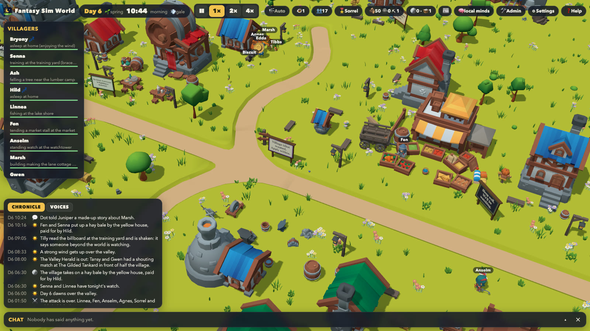

<picture>
  <source media="(prefers-color-scheme: dark)" srcset="public/logo.svg">
  
</picture>

# Fantasy Sim World

A 3D world in the KayKit style. A dozen fantasy villagers, each invented by a language model when the world begins, follow their days, talk, make friends and enemies, fall in love, fight the dead that rise from the graveyard at night and the orc raiders who now and then come up the road by day and, if pushed far enough, each other. The world runs on a server, around the clock; everyone who opens the page watches the same village from their own free top-down camera.

Each villager has a name, a profile, a personality, relationships and a memory that grows as the simulation runs. A language model makes their decisions through tool calls on any OpenAI-compatible endpoint; walking, working and fighting are simulated by the server and never wait for the model. With no model connected, villagers run on built-in routines, so the world is alive either way.



The design is in [docs/superpowers/specs/2026-10-01-fantasy-sim-world-design.md](docs/superpowers/specs/2026-10-01-fantasy-sim-world-design.md).
The move of the simulation, the language model and all state to a Rust server with authenticated viewers, and what was measured along the way, is in [docs/superpowers/specs/2026-10-02-backend-migration-plan.md](docs/superpowers/specs/2026-10-02-backend-migration-plan.md).

## Status

The server migration is complete. The world, the language-model brain and every piece of state live in the Rust server (`server/`); the browser is a viewer that draws the server's event stream (`src/`). What works today:

- The village simulation at 20 ticks a second, with routines, needs, conversations, relationships, night attacks, fights, deaths, graves and newcomers. A world resumes where it was after a restart.
- A new world founds itself: the language model invents each of its thirteen villagers, one request each, while viewers who join early watch the founding from a dialog; newcomers are invented the same way, in the background, when the road brings one. Without a model, the server invents them from its own lists (see [Founding and newcomers](#founding-and-newcomers)).
- Children: four or five live in the village from the day it is founded, and lovers who stay together have more. Children play, get into trouble (pinched food, a thrown apple, a hidden tool, a tall tale, a wander into the wilds at dusk, now and then a fire), never fight, and come of age after about a month as adults with a trade of their own ([the design](docs/superpowers/specs/2026-10-08-children-design.md)).
- Combat: fighters with a shield or a blade can block a blow, the nimble can dodge one, and every week or so an orc war band comes up the west road by day to plunder the farm, the stores, the market and empty homes. A raider who falls drops what it carried; what the band gets away with is gone ([the design](docs/superpowers/specs/2026-10-04-combat-design.md)).
- House fires: when not one villager is awake, the dead set a home alight. Everyone is woken to carry water from the well or the lake; a house they cannot save burns down and is rebuilt over several days, while the people who lived there sleep rough by the campfire ([the design](docs/superpowers/specs/2026-10-03-house-fire-design.md)).
- Weddings and funerals: a couple who stay together are married on the village green before everyone and move in together, and the dead are buried the next morning with the whole village at the graveside. The language model writes the vows and the eulogy ahead of time ([the design](docs/superpowers/specs/2026-10-08-weddings-funerals-design.md)).
- A world that changes: woodcutters fell real trees (which sway, fall and grow back over a fortnight), miners break rocks, farmers mow and dig, and anything but the dead's and the lamps can be taken apart or set alight, by routine or by the model. Wood, stone and ore are carried to stockpiles, and the village spends them raising what fell, enlarging crowded cottages and putting up fences, benches and crates ([the design](docs/superpowers/specs/2026-10-07-dynamic-world-design.md)).
- Music: a few villagers can sing or play, and of an evening one of them strikes up outside the tavern (now and then on the green). Whoever is idle within earshot comes to stand and listen; the drinkers listen from their stools. A good tune leaves its listeners in good spirits for a few hours (slower to tire, quicker to heal, a little braver), a poor one draws heckles and empties the yard ([the design](docs/superpowers/specs/2026-10-08-music-design.md)).
- Coin: villagers are paid for what they put down at the stores and for what they sell at the market's stalls, and spend it there; a passing trader buys the surplus once a day and fills the village chest. The dead drop coin and trinkets that villagers pick up, neighbours buy from one another, and whoever has saved enough pays for a bigger cottage or a wagon, a strongbox or a scarecrow for the yard ([the design](docs/superpowers/specs/2026-10-08-economy-design.md)).
- The dead have cards: click one of them and the inspector shows its health, what it is after, where and how it rose, who it once was and how many villagers it has slain.
- Five billboards around the village with a new slogan each morning. Villagers sometimes stop to read one, say what they think and, if it urges something, may go and do it; admins can put their own text up ([the design](docs/superpowers/specs/2026-10-03-billboards-design.md)).
- The language model on the server, with a request queue, a speed governor, daily caps, a decision log for admins and a fallback to routines.
- Everyone watches and chats as a guest, with a line when the seats are full (see [Guests](#guests)); admins hold a shared token. Local development without a token.
- Ambient sound, effects and adaptive music.
- A container image with Litestream backups and Fly.io settings, deployed from a GitHub Actions workflow started by hand ([docs/deploy.md](docs/deploy.md)).

Not yet done or not yet tried:

- **Models**: the figures under [Connecting a language model](#connecting-a-language-model) are from one local model (`qwen/qwen3.6-35b-a3b` in LM Studio). The deployed game uses hosted models (the help's tech tour says which), but they have not been measured the same way; run the `probe` tool against yours.
- **Later**: spoken lines (text to speech; the seam is in place), new places built from scratch, large bosses.

## What you need

- **Node.js 22** and **pnpm 10** (`corepack enable` picks the version in `package.json`), for the web client.
- **Rust 1.88 or newer** (stable), for the server.
- A browser with WebGPU or WebGL 2.
- Only for some tools: [Bun](https://bun.sh) (`pnpm audio` and the `.ts` tools), ffmpeg and bsdtar (`pnpm audio`), Blender (generated props), and the KayKit collection (rebuilding the models).

## Run

```bash
pnpm install
pnpm build                      # the web client, into dist/
cd server
AUTH_TOKEN=dev-token-0123456789 PUBLIC_ORIGIN=http://localhost:8080 STATIC_DIR=../dist LOG_FORMAT=pretty cargo run --release
```

Open <http://localhost:8080> and you are watching, as a guest, a world that keeps running while the server does; <http://localhost:8080/auth/token> and the token make you an admin. Every tab and every person watches the same world. The world, its history and the settings live in `server/data/world.db`; stop the server with Ctrl-C and it resumes where it was.

`PUBLIC_ORIGIN` is the address in the browser. It defaults to `http://localhost:5173`, the dev server's, and the CSRF check refuses changes (speed, admin actions) from any other origin, so set it whenever you browse the server directly.

For work on the client, run `pnpm dev` next to the server: it serves the client with hot reload on <http://localhost:5173> and forwards `/api` and `/auth` to `http://localhost:8080` (`SERVER_URL` changes it). Start the server without `PUBLIC_ORIGIN` (or with the dev server's address) and open `/auth/token` on the dev server's port once to become an admin.

To skip the token while developing, start the server with `AUTH_MODE=off` instead of `AUTH_TOKEN`: every browser on this machine is an admin. The server then listens on `127.0.0.1` only and refuses to start with a non-local `BIND_ADDR` or `PUBLIC_ORIGIN`. With `pnpm dev` that is all it takes; when the browser talks to the server directly on :8080, set `PUBLIC_ORIGIN` to match:

```bash
AUTH_MODE=off PUBLIC_ORIGIN=http://localhost:8080 STATIC_DIR=../dist LOG_FORMAT=pretty cargo run --release
```

Neither the server nor Vite reads a `.env` file. To keep your settings in one (it is git-ignored), export it into the shell and start everything from that shell:

```bash
set -a; . ./.env; set +a
```

### In the browser

- Drag to pan, scroll to zoom, right-drag or Q / E to turn, WASD or arrows to move.
- Shift or Option (Alt) + scroll, R / F, or right-drag up and down tilts the view, from low over the ground to straight down.
- Click a villager to follow them and open the inspector (profile, needs, what they carry and their gold, plan, relationships, memories). Click one of the dead, or a raider, to follow it and read its card instead.
- On a touch screen, one finger pans, pinching zooms, twisting two fingers turns and dragging two fingers up or down tilts.
- On a phone (either side under 600 or so pixels, portrait or landscape) the screen is simpler: a tab bar opens the villagers, the chronicle, the chat, the followed villager's page or the ☰ menu, one at a time. Tablets and opened foldables get the desktop layout.
- Admins set the speed for everyone: Space pauses; 1, 2 and 3 set 1×, 2× and 4×.
- ❓ Help in the top bar, or the ? or H key, lists the controls and explains what is on the screen (the stores, the village chest, the banners) and how the village works: children, the dead, raids, fires, the changing valley and coin. Its **About the tech** button opens a short tour of what the world is built with and how the language and embedding models fit in.
- `?renderer=webgl` or `?renderer=webgpu` forces a render backend; `?quality=low` or `?quality=high` forces the picture's quality (touch devices and machines with little memory get `low` by themselves: fewer pixels, a smaller shadow map, fewer lamps, thinner grass and 30 frames a second); `?debug=nav` shows the navigation grid and activity spots; `?render=off` follows the stream without drawing (for headless tests, where software WebGL is too slow).

The admin panel (🛠) has the speed, export, import and "new world", the text on the billboards, the language model's configuration (read-only) and a connection test, and the server's health. The 🧠 pill in the top bar opens the model's decision log.

### Server settings

All settings come from environment variables, read at start:

| Variable | Default | What it is |
| --- | --- | --- |
| `AUTH_MODE` | `token` | `token` (the admin's shared secret, [docs/sign-in.md](docs/sign-in.md)) or `off` (everyone is an admin; local development only) |
| `AUTH_TOKEN` | none | The admin's secret for `AUTH_MODE=token`, 16 characters or more |
| `MAX_VIEWERS` | `25` | How many people may watch at once; the rest wait in line. `0` for no cap (see [Guests](#guests)) |
| `PORT` or `BIND_ADDR` | `0.0.0.0:8080` (`127.0.0.1:8080` with `AUTH_MODE=off`) | Where the server listens; `BIND_ADDR` wins when both are set |
| `PUBLIC_ORIGIN` | `http://localhost:5173` | The address in the browser; the CSRF check uses it |
| `STATIC_DIR` | `dist` | The web build the server serves |
| `DATA_DIR` | `data` | Where `world.db` and its backups live |
| `INITIAL_SPEED` | `1` | Speed of a new world: `0` (paused), `1`, `2` or `4` |
| `TRUST_PROXY` | `false` | Take the client's address from `Fly-Client-IP` / `X-Forwarded-For`; only behind a proxy that sets them |
| `LOG_FORMAT` | JSON lines | `pretty` for humans |
| `LLM_*` | off | The language model ([below](#connecting-a-language-model)) |
| `EMBED_*` | off | Memory by meaning ([below](#memory-by-meaning)) |

A value the server cannot use stops it at start with a message naming the variable. Deploying to Fly.io, backups and health are in [docs/deploy.md](docs/deploy.md).

## Connecting a language model

The language model is configured only with environment variables on the server. Nothing about it can be set or changed from a browser. The server reads them at start, so a change takes effect on the next restart. Without `LLM_BASE_URL` and `LLM_MODEL` the model is off and the villagers follow their built-in routines. A value the server cannot use (a number out of range, an unknown choice, or only one of the two) stops it at start with a message naming the variable.

| Variable | Default | What it is |
| --- | --- | --- |
| `LLM_BASE_URL` | none | An OpenAI-compatible chat completions endpoint that supports tool calling, e.g. `https://api.openai.com/v1`. Set it together with `LLM_MODEL`. |
| `LLM_MODEL` | none | The model's name at that endpoint |
| `LLM_API_KEY` | none | The endpoint's key, sent as `Authorization: Bearer`. Local models need none. |
| `LLM_CONCURRENCY` | `2` | Requests at once, 1 to 16 |
| `LLM_REQUESTS_PER_MINUTE` | `40` | A hard cap per real minute; `0` is no cap |
| `LLM_MAX_REQUESTS_PER_DAY` | `0` | Requests per UTC day, spread through the day; `0` is no cap |
| `LLM_MAX_TOKENS_PER_DAY` | `0` | Prompt plus completion tokens per UTC day, spread through the day; `0` is no cap |
| `LLM_PROTOCOL` | `auto` | How tool calls travel: `tools` (native), `json` (JSON-schema output) or `auto` (detect) |
| `LLM_CONVERSATIONS` | `auto` | `batched` (one request per conversation), `turns` (one per line) or `auto` (chosen by speed) |
| `LLM_REASONING` | `off` | For models that think before answering: `off`, `low` or `default` (the model's own) |
| `LLM_TEMPERATURE` | `0.8` | 0 to 2 |
| `LLM_MAX_TOKENS` | `600` | Output tokens per answer, 100 to 4000 |
| `LLM_HEADERS` | none | Extra request headers, one `Name: value` per line (or separated by a literal `\n`) |

The server makes every request. The key and header values never reach a browser and are never part of an export. **🛠 Admin → Language model** shows the configuration the server is running with (the key only as its last four characters) and has **Test connection**, which asks the model for one real decision.

```bash
# A hosted model (on Fly.io: fly secrets set LLM_API_KEY=… LLM_BASE_URL=… LLM_MODEL=…)
LLM_BASE_URL=https://api.openai.com/v1 LLM_MODEL=<model> LLM_API_KEY=sk-… \
  AUTH_TOKEN=dev-token-0123456789 PUBLIC_ORIGIN=http://localhost:8080 STATIC_DIR=../dist cargo run --release

# Ollama or LM Studio, where the server can reach it (LM Studio is http://localhost:1234/v1)
LLM_BASE_URL=http://localhost:11434/v1 LLM_MODEL=<model> LLM_CONCURRENCY=1 \
  AUTH_TOKEN=dev-token-0123456789 PUBLIC_ORIGIN=http://localhost:8080 STATIC_DIR=../dist cargo run --release
```

- **Local models (Ollama, LM Studio)**: use a model that supports tools and set `LLM_CONCURRENCY=1`.
- **Reasoning models**: leave `LLM_REASONING` at `off`. A model that thinks before every answer is several times slower and can spend its whole output budget on thinking.
- **Daily caps**: `LLM_MAX_REQUESTS_PER_DAY` and `LLM_MAX_TOKENS_PER_DAY` are spread evenly through the day so the village does not go quiet in the evening. A world that runs around the clock asks a fast model about 20,000 times a day.
- **Upgrading from a version with model settings in the admin panel**: the settings and key it saved are deleted from the database on the first start, so set the `LLM_*` variables before deploying.

How the model is used:

- It is asked only at decision points: on waking (a plan for the day), when something notable happens, when a plan block ends, in danger (fight or flee), in conversations, when a beaten opponent yields (spare or finish), and once a night to reflect.
- Tool calls are sent natively. If a model answers in prose instead of calling its tool, the client switches to JSON-schema output, which local servers enforce with a grammar. Tested with `qwen/qwen3.6-35b-a3b` in LM Studio: 85% usable answers natively, 20 of 20 as JSON output, about 6 seconds each with reasoning off.
- A governor measures the endpoint's speed and keeps demand below it, so a slow local model gets fewer, more important requests. `LLM_REQUESTS_PER_MINUTE` is a hard cap on top of that. While the model has a backlog, a world running faster than 1× holds at 1×.
- Every answer is checked against the world as it is by then. Stale, invalid or missing answers fall back to the routines.
- The 🧠 pill in the top bar opens the decision log for admins: each prompt, the raw reply, the commands it produced, latency and tokens.

To measure a model before letting it run the village (real prompts from a world a few days in):

```bash
cd server && cargo run --release -p fsw-brain --bin probe -- http://localhost:11434/v1 <model> 20
```

To try the whole path with no model at all, run the mock endpoint (`MOCK_DELAY` sets its latency in milliseconds, `MOCK_MODE=text` makes it answer with JSON in the text):

```bash
node tools/mock-llm.mjs
```

and start the server against it:

```bash
cd server && LLM_BASE_URL=http://localhost:8787/v1 LLM_MODEL=mock EMBED_BASE_URL=http://localhost:8787/v1 EMBED_MODEL=mock-embed AUTH_TOKEN=dev-token-0123456789 PUBLIC_ORIGIN=http://localhost:8080 STATIC_DIR=../dist cargo run --release
```

### Founding and newcomers

A brand-new world has nobody in it. The server asks the model for one villager at a time (`create_villager`: a name nobody here has, pronouns, age, class, trade, a backstory, how they talk, traits, goals, a temper, and perhaps a secret, a quirk and a tie to someone already settled), a few requests at once, each told who has settled so far, until thirteen are here; then the first night comes. The people of the original hand-written cast are in the prompt for flavour only, and their names are refused. Viewers who join meanwhile see a dialog counting the arrivals and may look around the empty valley. When a bed is empty later, the sim asks for a newcomer the same way, with the recent dead and who misses them in the prompt, so a newcomer may come as kin or an old friend; the road waits six hours of the village's day for the answer. These requests go straight to the model, outside the brain's queue, governor, caps and decision log.

Without `LLM_BASE_URL` and `LLM_MODEL`, or when the model fails three times running, the server invents the villagers itself from the lists in `server/crates/sim/src/data/names.rs`. Either way, a villager is built inside the simulation from a command, so a world replays the same from its command record. The murderous and occultist leanings of the old cast are never given to an invented villager.

### Memory by meaning

Villagers recall memories by the people involved and the words they share with the moment. With an embedding model they recall by meaning instead, so a fire brings back "the flames at the mill" even when nobody said "fire". Any OpenAI-compatible `/v1/embeddings` endpoint works: LM Studio, Ollama or a hosted one. It can be a different server from the language model. Embeddings are used only while the language model is on: without it no prompt recalls anything, so nothing is embedded.

| Variable | Default | What it does |
| --- | --- | --- |
| `EMBED_BASE_URL` | none | The embeddings endpoint, e.g. `http://localhost:1234/v1`. Set it together with `EMBED_MODEL`. |
| `EMBED_MODEL` | none | The embedding model's name there, e.g. `text-embedding-nomic-embed-text-v1.5` |
| `EMBED_API_KEY` | none | Its key, if it needs one |

The server embeds each new memory in the background (a few hundred short texts a day for a village), keeps the vectors in the database, and embeds what a decision, a reply or a morning plan is about when it asks the model. If the endpoint is slow (over two seconds) or down, recall falls back to shared words, and nothing else changes. The vectors are a cache: changing the model starts a fresh set, and vectors unused for a week are deleted. Embedding requests do not count against `LLM_MAX_REQUESTS_PER_DAY` or `LLM_MAX_TOKENS_PER_DAY`; **🛠 Admin → Language model → Test connection** tests both models. To check an endpoint first: `cargo run --release -p fsw-brain --bin probe -- <base-url> <model> 4 --embed <embed-model>`.

## Guests

Everyone who opens the page is a guest: there is nothing to sign up for or into. The page asks the server for a seat and, with one, shows the valley (with `AUTH_MODE=off` everyone is an admin and needs no seat).

- **Seats.** At most `MAX_VIEWERS` guests (25 unless set; `0` for no cap) watch at once. A guest's seat is a cookie that the browser's tabs share; it holds one stream, and a newer tab takes it over from an older one. A seat is kept for as long as its holder watches.
- **The line.** When every seat is taken, the launch screen shows the guest's place in line and asks again once a minute; the server refuses asks that come sooner. A seat that comes free goes to whoever is first in line. Closing the page gives up the place after three minutes, and closing the world gives up the seat after one.
- **Watching and talking.** Guests are anonymous. They look around, follow villagers, read the chat and write in it under a name of their choosing (see [Chat](#chat)). Only the admin routes answer `403` to a guest.
- **Leaving.** Settings has a **Leave** button, which gives the seat to the next person straight away.
- **Admins.** With `AUTH_MODE=token`, the link at the bottom of Settings leads to `/auth/token`; the token makes the browser an admin instead of a guest ([docs/sign-in.md](docs/sign-in.md)).
- The seats and the line live in memory; a restart empties them, and the browsers ask again.

## Chat

Everyone watching shares a chat along the bottom of the screen. It can be expanded, collapsed to one line showing the latest message, or hidden behind a 💬 button that counts what you missed.

- Each person gets a made-up name when they connect ("Mossy Wren"). Settings changes it, as long as nobody else in the chat has it (ignoring case). The chosen name is kept in this browser and asked for on each connect; if someone else has it by then, you get a made-up one.
- The chat says when someone joins and when they leave. A reload, or a tab that was hidden for a while, drops the connection for a moment, so someone only counts as gone after five minutes away; back sooner, and neither is mentioned. Until then their name stays theirs.
- A guest's tabs share the seat, so they share one name. Admins all hold the same token, so each admin tab is its own person.
- The server keeps the last 50 messages, in memory, and sends them to everyone who connects. They survive a new world but not a server restart.
- A message is at most 500 characters, text only. It may use **bold**, *italic* (or _italic_), ~~strikethrough~~, `code`, fenced code blocks, links (`[text](https://…)` or a bare `https://…` address; nothing but http and https) and emoji, from your keyboard or the 😀 picker. Nothing in a message is ever treated as HTML.
- Each person may send about one message a second, in bursts of up to five.
- Every message passes through `filter` in [server/crates/server/src/chat.rs](server/crates/server/src/chat.rs) before anyone sees it. It allows everything for now; it is where moderation goes.

## Sound

The game ships ambient loops, effects and background music, all CC0, public domain or CC BY ([credits](public/audio/CREDITS.md)). The ambience follows the camera, the time of day and what the villagers are doing. The music follows what you are watching, from calm day, evening and night pieces to tension when the alarm is up or monsters are near, battle when a fight is in view, and grief after a death, with short victory and defeat stings. While a villager sings or plays in view, the minstrel pieces stand in for their tune. Settings turns ambience, effects and music on or off, and sets their volumes, in this browser only.

The files are built by `pnpm audio` (`tools/audio/build-audio.ts`, which needs Bun, ffmpeg and bsdtar) from the sources listed in `tools/audio/sources.ts`. To swap a sound, change its entry there and rebuild, or drop your own file into `public/audio/` under the slot's name ([public/audio/README.md](public/audio/README.md)). Only CC0, public-domain or CC BY sounds go in, each credited in `public/audio/CREDITS.md`.

Character speech is not implemented yet, but the seam is in place: every spoken line arrives from the server complete, with the speaker's voice profile, position and duration, and passes through `SpeechBus` ([src/speech/speechBus.ts](src/speech/speechBus.ts)), so a text-to-speech sink can be added in the browser without touching the server.

## Tests and tools

What CI runs ([.github/workflows/ci.yml](.github/workflows/ci.yml)) on every push and pull request:

```bash
pnpm typecheck && pnpm test     # the client
cd server && cargo fmt --check && cargo clippy --all-targets --locked -- -D warnings && cargo test --locked
```

- `pnpm test` covers the client's stream playback, the view of the world it builds from the stream, the world layer, the audio mood and settings, and the architecture rules (the browser never reaches the simulation, the brain or saves; three.js stays in `src/render`).
- `cargo test` covers the Rust world against golden fixtures from the TypeScript version, the sim (determinism through a save round trip, invariants over several days, a 20-day run), old browser saves still loading, the founding of a village and its newcomers, the prompts byte for byte, the brain against a fake model, the casting against a fake model, the store, and the HTTP routes (the admin's token, guest seats and the line, the chat, the world's routes). The tests that know villagers by name use the original hand-written cast, kept in `server/crates/testing` for them.
- `cargo test -- --ignored` adds the 200-day soak, a 60-day check that the village does not level its own trees and homes, and, with `node tools/mock-llm.mjs` running, a real HTTP round trip to the mock model.
- Two committed files are written by the server and checked by its tests. In `server/`, after changing a type in `server/crates/server/src/api/wire.rs`, run `cargo run --bin export-api` (rewrites `src/generated/api.ts`); after changing the stream encoder, run `cargo run --bin export-frames` (rewrites `tests/fixtures/server-frames.json`, which the client's tests replay).

Other tools:

- `cargo run --release -p fsw-sim --bin soak -- 30 1337 --log` runs the world headlessly for 30 days (seed 1337) and prints its chronicle; `--json` prints statistics, `--trace` one line per tick.
- `AUTH_TOKEN=… node tools/sse-probe.mjs <url> [seconds]` checks that the event stream reaches a client through a hosting proxy unbuffered.
- `bun tools/assets/export-server-data.ts` writes `server/data/*.json` (model bounds, clip durations, tile heights) from `src/generated`; `pnpm assets` writes them too.
- `bun tools/dump-world.ts [outDir]` writes the TypeScript world layer's output as the golden fixtures the Rust world is checked against.

## How it is put together

| Folder | What it holds |
| --- | --- |
| `src/core` | Seeded RNG, 2D maths, game time |
| `src/world` | The hex map, places and activity spots, scatter, navigation grid, pathfinding (terrain, scenery and camera bounds in the browser) |
| `src/net` | The event stream, the world as this viewer knows it, the jitter buffer, REST calls |
| `src/render` | three.js scene, actors, effects, labels, camera, lighting, animation table; the trees and rocks, buildings and marks the server can change |
| `src/ui` | The HUD, chat, admin panel and the launch screen with the line for a seat (Preact and signals) |
| `src/audio`, `src/speech` | Ambient mixer, music and the speech bus |
| `src/generated` | Wire types (from the Rust server), asset manifest, tile heights; never edited by hand |
| `tests` | Client tests that span layers: architecture rules, stream replay, server data |
| `tools` | Asset and audio builds, Blender prop generator, mock model endpoint, stream probe, world dump for the golden fixtures |
| `server` | The Rust server, a Cargo workspace: `core` and `world` (shared maths and the static world), `sim` (the simulation), `brain` (the language model: client, queue, governor, prompts, casting, validation), `server` (HTTP, event stream, chat, guest seats and the admin's token, SQLite store), `testing` (the original cast, for tests) |
| `deploy`, `Dockerfile`, `fly.toml` | The container image, Litestream and Fly.io settings ([docs/deploy.md](docs/deploy.md)) |

On the server the sim depends only on `core` and `world`; the brain reads the world and talks to the sim through commands applied at tick boundaries, so a run is reproducible for a given command stream. The browser depends on `core`, `world`, `net` and `generated`, never on the sim.

The TypeScript simulation, brain, browser saves and reference server that the Rust port was checked against are kept at the `ts-sim-reference` tag (`git checkout ts-sim-reference`), with the tools that compare the two (`bun tools/soak.ts … --trace`, `python3 tools/soak-parity.py`, and the fixture writers). Comments in the Rust crates that name `src/sim/…` or `src/brain/…` files refer to that tag.

## Assets

The 3D models are from the [KayKit](https://kaylousberg.com) collection by Kay Lousberg (CC0). The processed subset the game uses is committed under `public/assets/`. To rebuild it from the original collection:

```bash
KAYKIT_DIR="/path/to/The Complete KayKit Collection v7" pnpm assets
```

The build packs the models with meshopt compression, shrinks the palette textures to 256 pixels a side, and gives every URL in the manifest a hash of its file (`?v=…`), because the server lets browsers keep `/assets` for a year.

Characters come on two skeletons: most use KayKit's medium rig, and the Greymane brothers use `Barbarian_Large` on the large rig. Each rig gets its own clip file in `public/assets/animations/`. The large rig has no work, rest or ranged clips of its own, so the build copies those over from the medium rig, adjusted to the longer bones (`rigs` in `tools/assets/asset-list.mjs`). The sim times actions by the medium rig's clips, and the client stretches the large rig's one-off clips, such as attacks, to finish at the same moment.

A few props the collection lacks at character scale (a wooden fence, wildflowers, mushrooms, a notice board) are generated with Blender and bundled by the same command:

```bash
/Applications/Blender.app/Contents/MacOS/Blender -b -P tools/blender/make_props.py
```

## Working on the code

[AGENTS.md](AGENTS.md) has the rules a change has to keep (for people and coding agents alike), with more for the server in [server/AGENTS.md](server/AGENTS.md) and for the web client in [src/AGENTS.md](src/AGENTS.md).
